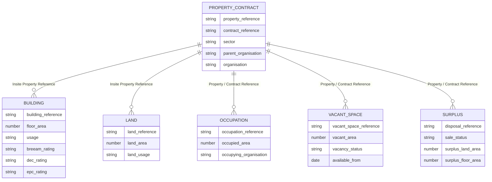

# GovMove

Streamlit Databricks App for exploring the government property estate and finding available space, co-location and
planning opportunities. Distances are straight-line distances on British National Grid (EPSG:27700) Easting/Northing.

## Quick start (complete setup order)

Everything lands in one Unity Catalog location, `<catalog>.<schema>` (development: `manual_sandbox_dev.property_prioritisation`).

1. **Run GovMove Setup** (section 1) with `catalog`, `schema`, `addressbase_table` and `priority_table` set. This lands the six source datasets and AddressBase Premium and builds the app tables. On the first run the priority table does not exist yet, so the priority columns in `govmove_property_evidence` are left empty.
2. **Run the prioritisation notebook** (`govmove/Government Property Sustainability and Investment Prioritisation`, section 1a). It reads the six source tables from step 1 and writes `property_priority_results`, plus its own supporting tables, to the same schema.
3. **Re-run GovMove Setup** with the same widget values, keeping `overwrite_existing = false`. The source tables are kept, and the app tables are rebuilt with the priority scores.
4. **Configure `app.yaml`** (section 2) with the same catalog, schema, AddressBase and priority-table values.
5. **Grant the app's service principal access** and **deploy** (see *Deploying as a Databricks App*).

To refresh from data.gov.uk later, run step 1 with `overwrite_existing = true`, then steps 2 and 3 again. Run both notebooks interactively on serverless compute, or as a one-off job run. In a job, the GovMove Setup widgets are passed as task parameters. The prioritisation notebook has no widgets.

## 1. Setup: one landing location

Run the **GovMove Setup** notebook (`govmove/GovMove Setup`). Its widgets are:

| Widget | Meaning | Development value |
| --- | --- | --- |
| `catalog` | Landing catalog for all datasets and app tables | `manual_sandbox_dev` |
| `schema` | Landing schema for all datasets and app tables | `property_prioritisation` |
| `addressbase_mode` | `table` (view over an existing table) or `volume` (load CSV files) | `table` |
| `addressbase_table` | Existing AddressBase Premium table (table mode) | `address_dev.bronze.addressbasepremium` |
| `addressbase_volume_path` | `/Volumes/...` folder of AddressBase Premium CSV files (volume mode) | not used |
| `overwrite_existing` | `true` re-downloads and replaces source tables that already exist | `false` |
| `priority_table` | Optional `property_priority_results` table from the prioritisation notebook | `manual_sandbox_dev.property_prioritisation.property_priority_results` |
| `irish_grid_epsg` | Irish Grid EPSG code | `29903` |

The notebook:
1. Downloads the six Government Property Estate XLSX files from [data.gov.uk](https://www.data.gov.uk/dataset/a3ad62cf-d8a2-4d3b-b3c6-24c35c5e0f71/the-government-property-estate-including-buildings-and-land) (Open Government Licence). It finds them through the CKAN API and lands them as `property`, `building`, `land`, `occupation`, `surplus` and `vacant_space`, with the published column names.
2. Makes AddressBase Premium (Ordnance Survey, licensed) available as `addressbasepremium`. The table must have at least `postcode`, `easting`, `northing`, `latitude`, `longitude`, `effectiveenddate` and `addressstatus`.
3. Builds the app objects in the same schema:
   * views `govmove_property_clean`, `govmove_building_clean`, `govmove_land_clean`, `govmove_occupation_clean` and `vw_govmove_property_locations`
   * tables `govmove_property_locations`, `govmove_postcode_centroids` and `govmove_property_evidence`

It needs serverless compute, or a cluster on Databricks Runtime 17.1+ (for `st_transform`), with internet access to data.gov.uk.
Source tables keep the published column names, which contain spaces. They are therefore written with Delta column mapping (`delta.columnMapping.mode = name`).
The person running it needs `USE CATALOG` and `CREATE SCHEMA` (or `CREATE TABLE` on an existing schema) in the landing catalog, and `SELECT` on the AddressBase Premium source table.

## 1a. Priority scores (prioritisation notebook)

Run **Government Property Sustainability and Investment Prioritisation** (`govmove/`) after the first GovMove Setup run. Its settings are in the *Configuration settings* cell (no widgets):

| Setting | Meaning | Development value |
| --- | --- | --- |
| `SOURCE_CATALOG`, `SOURCE_SCHEMA` | Where GovMove Setup landed the six source tables | `manual_sandbox_dev`, `property_prioritisation` |
| `TARGET_SCHEMA` | Where the outputs are written (keep it the same as the landing schema) | `manual_sandbox_dev.property_prioritisation` |
| `WEIGHTS`, `PRIORITY_BANDS`, thresholds | Documented scoring rules | see the notebook |

It writes `property_priority_results` (one row per Insite Property Reference). It also writes `property_master`, `property_clean`, `building_clean`, `occupation_clean`, `land_clean`, `surplus_clean`, `vacant_space_clean`, `property_location_matches`, `property_data_quality_issues`, `column_mapping` and the `stg_*` staging tables. None of these names clash with the GovMove Setup objects. Then re-run GovMove Setup so that `govmove_property_evidence` picks up the scores.

## 2. App configuration (`app.yaml`)

| Env var | Meaning | Development value |
| --- | --- | --- |
| `GOVMOVE_CATALOG` | Same as the setup `catalog` widget | `manual_sandbox_dev` |
| `GOVMOVE_SCHEMA` | Same as the setup `schema` widget | `property_prioritisation` |
| `GOVMOVE_ADDRESSBASE_TABLE` | AddressBase Premium table or view for the postcode-lookup fallback: a bare name (resolved in the landing schema) or a full `catalog.schema.table` | `manual_sandbox_dev.property_prioritisation.addressbasepremium` |
| `GOVMOVE_PRIORITY_TABLE` | Optional priority results table (full name) | `manual_sandbox_dev.property_prioritisation.property_priority_results` |
| `GOVMOVE_COMPUTE` | `serverless` or an all-purpose cluster ID for Databricks Connect | `serverless` |
| `GOVMOVE_AVAILABILITY_RULES` | Optional JSON overriding the default statuses (see `config.py`) | vacant space: `Available`; surplus: `On the Market`, `Not on the Market` |

`config.py` derives every table name from `GOVMOVE_CATALOG` and `GOVMOVE_SCHEMA`, except AddressBase Premium (`GOVMOVE_ADDRESSBASE_TABLE`) and the priority table (`GOVMOVE_PRIORITY_TABLE`).

## Views (based on the Government Estate Intelligence template)

* **Estate Intelligence:** Estate overview (dataset cards, national map with layers, records by region/usage/organisation), Property explorer (search plus source-level detail tabs), Buildings, Land, Occupation, Vacant space, Surplus property, Co-location, Data quality.
* **Estate Planning & Decision Support:** a task landing page with a What If? panel, plus seven tasks: Find space, Find co-location opportunities, Building utilisation explorer, Government footprint explorer, Vacant space finder (the postcode search), Estate opportunity explorer and Sustainability & investment prioritisation.
* Not yet built from the template: the AI Estate Assistant (question and answer), the organisation-to-property relationship network diagram, and the header search box.


## Files

* `GovMove Setup` (notebook): lands the datasets and builds the app tables (section 1).
* `Government Property Sustainability and Investment Prioritisation` (notebook): builds `property_priority_results` (section 1a). The copy in the parent folder still reads the retired `manual_sandbox_dev.bronze` tables; use the one in `govmove/`.
* `main.py`: app entry point (header, logo, mode navigation).
* Views: `estate_views.py`, `planning_views.py`, and `prioritisation_views.py` with `prioritisation_core.py` (Sustainability & investment prioritisation).
* `data_access.py`: Spark session, cached queries and location resolution.
* `govmove_core.py`: `normalise_postcode`, `get_postcode_coordinates`, `calculate_straight_line_distance`, and the Spark filter/search functions.
* `config.py`: configuration (section 2).
* `app.yaml`, `requirements.txt`: app runtime.
* `assets/`: logo (`govmove_logo.svg`). Add `govmove_logo.png` or `govmove_icon.png` to override the logo or the browser tab icon.
* `tests/test_govmove_core.py`: unit tests.
* `app.py`: legacy single-page postcode finder, kept for reference.
* The older **GovMove Data Preparation** notebook (parent folder) is superseded by `GovMove Setup`.

## How it works

1. **Setup notebook.**
   * `vw_govmove_property_locations` unions vacant-space and surplus records, normalises postcodes and parses dates.
   * It classifies each record's coordinates and converts genuine Northern Ireland Irish Grid (EPSG:29903) `NI Easting`/`NI Northing` to BNG with `st_transform`. Records that cannot be compared reliably are labelled (`coordinate_status`, `coordinate_note`).
   * The view is materialised as `govmove_property_locations`.
   * `govmove_postcode_centroids` holds the mean BNG Easting/Northing of current AddressBase Premium address points per postcode. AddressBase Premium Northern Ireland (BT) addresses are already in BNG, so all postcodes and properties share one CRS.
2. **App.**
   * The postcode is normalised and validated, then resolved to BNG.
   * Filtering, `sqrt((E2-E1)^2 + (N2-N1)^2)`, the distance filter, sorting and the limit all run in Spark. Only the final results are converted to pandas.
   * Latitude/longitude are used only to draw the map.

Distances are straight-line, not road or travelling distance.

## Deploying as a Databricks App

1. Complete steps 1–3 of the *Quick start*: GovMove Setup, then the prioritisation notebook, then GovMove Setup again.
2. Set `GOVMOVE_CATALOG`, `GOVMOVE_SCHEMA`, `GOVMOVE_ADDRESSBASE_TABLE` and `GOVMOVE_PRIORITY_TABLE` in `app.yaml` (section 2).
3. Grant the app's service principal (shown on the app's **Overview** page) read access:
   ```sql
   GRANT USE CATALOG ON CATALOG <catalog_name> TO `<app-service-principal-id>`;
   GRANT USE SCHEMA, SELECT ON SCHEMA <catalog_name>.<schema_name> TO `<app-service-principal-id>`;
   -- only if GOVMOVE_PRIORITY_TABLE is in a different schema (not needed when it is in the landing schema):
   GRANT SELECT ON TABLE <priority_table> TO `<app-service-principal-id>`;
   ```
   The `addressbasepremium` view reads its source table with the view owner's permissions, so the app does not need access to that source table.
   If `GOVMOVE_ADDRESSBASE_TABLE` points at a table outside the landing schema, also grant `USE CATALOG`, `USE SCHEMA` and `SELECT` on it.
   If `GOVMOVE_COMPUTE` is a cluster ID, also give the service principal **Can Attach To** on that cluster.
4. Deploy from the workspace folder:
   ```
   databricks apps get govmove --output JSON          # compute must be ACTIVE
   databricks apps start govmove                      # only if compute is STOPPED
   databricks apps deploy govmove --source-code-path /Workspace/Users/<user>/govmove
   ```
   You can also click **Deploy** on the app page in the Databricks UI.
5. Open the app URL. Share it with users through the app's **Permissions** (Can Use).

## Running the tests

```
pip install pytest databricks-connect==15.4.*
pytest -q tests
```

The Spark distance tests skip automatically when no Spark session is available.


# Property Data, AI and Sustainability Hackathon Context

A hackathon application that brings together government property information to help users understand the estate, identify underused assets, and explore opportunities to improve utilisation and sustainability.

The application combines property, building, occupation, land, contract, vacant-space and surplus records into a single searchable view. It is designed to turn fragmented estate data into practical insights for property teams, analysts and decision-makers.

## The problem

Property information is often spread across several datasets. A user may need to move between property records, building details, occupations, vacant-space listings and surplus-property information before they can understand a site.

This makes it difficult to answer questions such as:

- What buildings and land are associated with a property?
- Who occupies the property and how much space do they use?
- Is any space vacant, available or under offer?
- Has the property, building or land been identified as surplus?
- What contracts and organisations are associated with the asset?
- What environmental or energy information is available for the building?
- Which assets should be investigated first for consolidation, reuse or disposal?

## Our solution

The application creates a joined-up property intelligence experience around a shared set of property and contract references.

Users can:

1. Search and filter the government estate by property, organisation, location and region.
2. View a consolidated profile of a property and its related records.
3. Explore buildings, land parcels, occupations, contracts, vacant spaces and surplus assets.
4. Compare occupied, vacant and surplus space to identify potential underutilisation.
5. review building-level sustainability indicators, including available EPC, DEC and BREEAM information.
6. Use AI-assisted summaries and natural-language questions to make complex property data easier to understand.
7. Highlight potential opportunities for space reuse, estate consolidation, disposal or further sustainability assessment.

> The application supports investigation and prioritisation. It does not replace professional property, legal, valuation, planning, security or sustainability advice.

## Data used

The prototype uses six Excel datasets.

| Dataset | Purpose | Examples of information included |
|---|---|---|
| `PropertyContract.xlsx` | Connects properties to contracts and organisations | Property and contract references, sector, parent organisation and organisation |
| `Building.xlsx` | Describes buildings and their environmental credentials | Floor area, usage, construction date, listed status, BREEAM, DEC and EPC information |
| `Land.xlsx` | Describes land associated with properties | Land references, area, measurement basis and land usage |
| `Occupation.xlsx` | Records how property space is occupied | Occupying organisation, occupation details, floor area and related references |
| `VacantSpace.xlsx` | Identifies vacant and potentially reusable space | Vacant area, measurement units, status, availability dates and descriptions |
| `Surplus.xlsx` | Identifies property or land in the disposal pipeline | Sale status, surplus land area, surplus floor area, title information and land usage |

The datasets contain shared identifiers such as **Insite Property Reference** and **Insite Contract Reference**. These identifiers allow the application to connect records that describe different aspects of the same asset.

## Conceptual data model



The diagram is conceptual. Exact relationship cardinality and data quality should be confirmed during production data modelling.

## Key application journeys

### 1. Estate overview

The overview presents high-level information about the property portfolio, for example:

- properties and buildings by region;
- floor and land area;
- occupied, vacant and surplus space;
- vacant-space status;
- surplus sale status;
- organisations represented in the data; and
- availability of EPC, DEC and BREEAM information.

### 2. Property search

Users can narrow the estate using fields such as:

- property name or reference;
- postcode, town, local authority or region;
- sector, parent organisation or organisation;
- building or land use;
- vacant-space status;
- surplus sale status; and
- security classification.

### 3. Property profile

A property profile brings associated records together in one place:

- address and geographical information;
- owning or responsible organisations;
- contracts;
- buildings and floor areas;
- land records;
- occupations;
- vacant spaces;
- surplus or disposal records; and
- sustainability and energy-certificate fields.

### 4. AI-assisted exploration

The AI layer is intended to make the estate data easier to interrogate. Example questions include:

- "Show vacant office space in Yorkshire and the Humber."
- "Summarise this property's buildings, occupations and vacant space."
- "Which properties have both vacant space and a surplus record?"
- "Which large buildings do not have a recorded EPC or DEC rating?"
- "Where could consolidation or reuse be investigated?"

AI-generated responses should explain the records used and distinguish source facts from inferred opportunities.

### 5. Sustainability opportunities

The application can help teams identify candidates for further review, including:

- buildings with missing or expired energy information;
- large floor areas with no recorded EPC, DEC or BREEAM result;
- properties with both occupied and vacant space;
- vacant buildings that may be suitable for reuse before new space is acquired;
- surplus assets where reuse and disposal options should be compared; and
- potential consolidation opportunities within the same location or organisation.

These are indicators for investigation, not automated decisions.

## Example opportunity logic

A simple prioritisation model can combine several transparent indicators:

| Indicator | Example interpretation |
|---|---|
| High vacant area | Potential reuse, subletting or consolidation opportunity |
| Vacant and surplus records both present | Review the intended asset strategy and disposal status |
| High floor area and missing EPC/DEC | Prioritise data improvement or an energy assessment |
| Several occupations at one property | Check whether space is being shared efficiently |
| Availability date has passed | Confirm whether the vacancy is still current |
| Zero or missing area values | Flag the record for data-quality review |

Any score should remain explainable, configurable and reviewable by a property professional.

## Data-quality considerations

The source files demonstrate several issues that a production implementation should handle explicitly:

- blank and zero area values;
- different area measurement standards and units;
- repeated records for the same property or building;
- inconsistent naming and capitalisation;
- dates that may be missing, historic or incorrectly formatted;
- properties with coordinates but incomplete addresses;
- multiple records linked to one property or contract; and
- certificate fields that may be absent even when a building exists.

Recommended controls include schema validation, reference-integrity checks, unit normalisation, duplicate detection, date validation and clear reporting of missing data.

## Responsible AI and governance

The application should follow these principles:

- **Grounded responses:** AI answers should be based on retrieved property records.
- **Traceability:** Users should be able to see which records support an answer.
- **Human review:** Recommendations must be reviewed before operational decisions are made.
- **Explainability:** Opportunity flags and scores should expose the underlying rules.
- **Security:** Respect the source security classification and the user's access permissions.
- **Data minimisation:** Send only the data needed for the user's question to an AI service.
- **No unsupported claims:** Missing information must be reported as missing rather than guessed.
- **Monitoring:** Record feedback, errors and model behaviour to support continuous improvement.


## Testing

A production-ready version should include:

- schema tests for each input file;
- relationship tests for shared property and contract references;
- tests for area and date normalisation;
- duplicate and null-value checks;
- permission and security-classification tests;
- grounded-AI evaluation questions with expected source records; and
- user-acceptance tests for search, filtering and property summaries.

## Future development

Potential next steps include:

- interactive mapping and spatial clustering;
- automated data-quality reporting;
- configurable opportunity scoring;
- carbon and energy benchmarks;
- certificate-expiry alerts;
- integration with authoritative property systems and APIs;
- scenario modelling for consolidation and reuse;
- feedback capture for AI answers; and
- exportable property briefing packs.

## Project status

This repository contains a hackathon prototype. Before production use, the solution will require formal assurance covering data ownership, security, accessibility, architecture, operational support, AI governance and user testing.

## Licence

Add the agreed repository licence here. For an open-source repository, include a `LICENSE` file and confirm that the source datasets can legally be redistributed.
